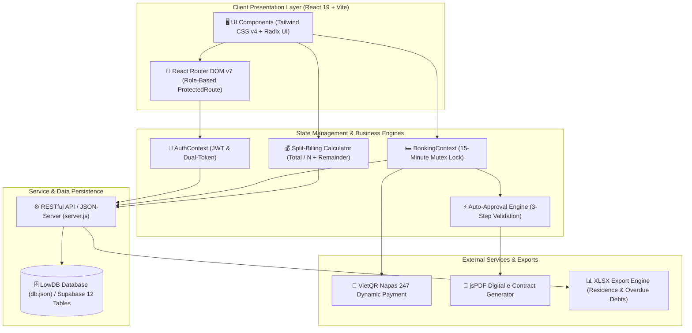
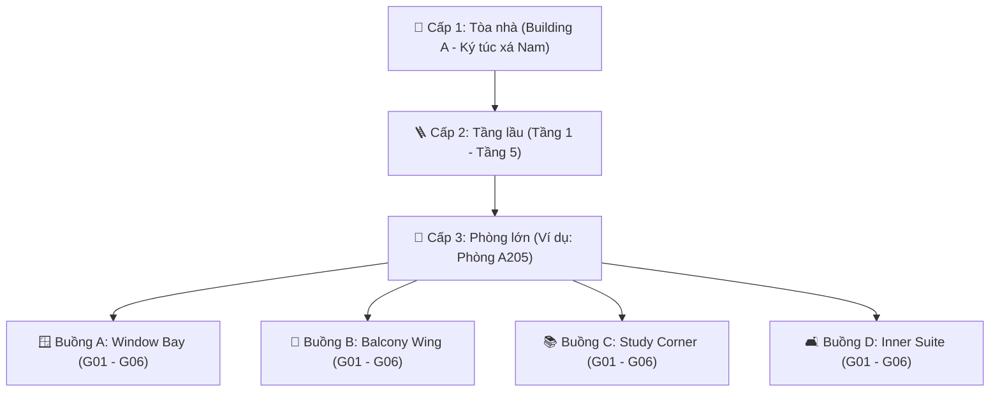

# BÁO CÁO DỰ ÁN MÔN HỌC (PROJECT REPORT)
## MÔN HỌC: FER202 – FRONT-END WEB DEVELOPMENT WITH REACT
### ĐỀ TÀI: DOMANAGE – HỆ THỐNG QUẢN LÝ KÝ TÚC XÁ TRỰC TUYẾN
*(ONLINE DORMITORY MANAGEMENT SYSTEM – DMS)*

---

> **TRƯỜNG ĐẠI HỌC FPT – KHOA CÔNG NGHỆ THÔNG TIN**  
> **Giảng viên hướng dẫn:** ThS. Giảng viên Bộ môn FER202  
> **Nhóm thực hiện:** FER202_Group4  
> **Thời gian hoàn thành:** Tháng 10/2026  

---

### DANH SÁCH THÀNH VIÊN THỰC HIỆN DỰ ÁN

| STT | Họ và Tên | MSSV | Vai trò chính trong dự án | Phân hệ phụ trách chính |
| :-: | :--- | :---: | :--- | :--- |
| **1** | **Nguyễn Hoàng Vinh** | SE170001 | Project Manager & Full-Stack Lead | Module 1: Auth (OAuth 2.0, JWT, Profile), Base Setup |
| **2** | **Trần Công Tiến** | SE170002 | Frontend Lead & UI/UX Designer | Module 2 & 3: Bản đồ 1:4:6, Giữ chỗ 15m, VietQR UI |
| **3** | **Trần Thanh Nguyên** | SE170003 | Backend Engineer & Database Architect | Database Schema 12 bảng, Auto-Approval, e-Contract PDF |
| **4** | **Văn Thái Trung** | SE170004 | Frontend Developer & Integration Specialist | Module 4: Ghi số công tơ, Chia tiền $Total/N$, Handover |
| **5** | **Đinh Thanh Trung** | SE170005 | Backend Developer & Security Analyst | Module 5: Ticket Bảo trì, Module 6: Giới nghiêm 23:00, Module 7: Dashboard |
| **6** | **Huỳnh Gia Kim** | SE170006 | Quality Assurance (QA) & Test Engineer | 90 Test Cases (4 Edge-cases), Responsive, Slide & Demo |

---

## 📑 MỤC LỤC BÁO CÁO (TABLE OF CONTENTS)

- [Lời Cam Đoan](#lời-cam-đoan)
- [Lời Cảm Ơn](#lời-cảm-ơn)
- [Tóm Tắt Đề Tài (Abstract)](#tóm-tắt-đề-tài-abstract)
- [Chương 1: Giới Thiệu và Đặt Vấn Đề](#chương-1-giới-thiệu-và-đặt-vấn-đề)
  - [1.1. Bối cảnh và Lý do chọn đề tài](#11-bối-cảnh-và-lý-do-chọn-đề-tài)
  - [1.2. Mục tiêu của Dự án](#12-mục-tiêu-của-dự-án)
  - [1.3. Phạm vi của Đề tài](#13-phạm-vi-của-đề-tài)
  - [1.4. Đối tượng sử dụng Hệ thống (Stakeholders & Actors)](#14-đối-tượng-sử-dụng-hệ-thống-stakeholders--actors)
- [Chương 2: Phân Tích Yêu Cầu Hệ Thống](#chương-2-phân-tích-yêu-cầu-hệ-thống)
  - [2.1. Danh mục Yêu cầu Chức năng (28 Use Cases)](#21-danh-mục-yêu-cầu-chức-năng-28-use-cases)
  - [2.2. Đặc tả Chi tiết các Use Case Trọng tâm](#22-đặc-tả-chi-tiết-các-use-case-trọng-tâm)
  - [2.3. Yêu cầu Phi chức năng (Non-Functional Requirements)](#23-yêu-cầu-phi-chức-năng-non-functional-requirements)
- [Chương 3: Kiến Trúc Hệ Thống và Thiết Kế Dữ Liệu](#chương-3-kiến-trúc-hệ-thống-và-thiết-kế-dữ-liệu)
  - [3.1. Kiến trúc Kỹ thuật Tổng thể](#31-kiến-trúc-kỹ-thuật-tổng-thể)
  - [3.2. Mô hình Không gian Phân cấp 1:4:6 (Spatial Topology)](#32-mô-hình-không-gian-phân-cấp-146-spatial-topology)
  - [3.3. Thiết kế Cơ sở Dữ liệu 12 Thực thể (Database Schema)](#33-thiết-kế-cơ-sở-dữ-liệu-12-thực-thể-database-schema)
- [Chương 4: Hiện Thực các Phân Hệ Cốt Lõi](#chương-4-hiện-thực-các-phân-hệ-cốt-lõi)
  - [4.1. Module 1: Phân quyền RBAC & Điều hướng Tự động](#41-module-1-phân-quyền-rbac--điều-hướng-tự-động)
  - [4.2. Module 2 & 3: Bản đồ Giường 1:4:6 và Động cơ Auto-Approval](#42-module-2--3-bản-đồ-giường-146-và-động-cơ-auto-approval)
  - [4.3. Module 4: Quản lý Công tơ & Chia đều Tiền Điện Nước](#43-module-4-quản-lý-công-tơ--chia-đều-tiền-điện-nước)
  - [4.4. Module 5: Phân hệ Tiếp nhận Báo hỏng & Bảo trì](#44-module-5-phân-hệ-tiếp-nhận-báo-hỏng--bảo-trì)
  - [4.5. Module 6: Thẻ QR Di động & Giờ Giới Nghiêm 23:00](#45-module-6-thẻ-qr-di-động--giờ-giới-nghiêm-2300)
  - [4.6. Module 7: Bảng điều khiển Quản trị & Báo cáo Excel](#46-module-7-bảng-điều-khiển-quản-trị--báo-cáo-excel)
- [Chương 5: Đảm Bảo Chất Lượng và Kiểm Thử Phần Mềm](#chương-5-đảm-bảo-chất-lượng-và-kiểm-thử-phần-mềm)
  - [5.1. Kiểm thử 4 Ca Biên Then chốt (Critical Edge-cases)](#51-kiểm-thử-4-ca-biên-then-chốt-critical-edge-cases)
  - [5.2. Ma trận Kết quả Thực thi Kiểm thử 90 Ca Kiểm Thử](#52-ma-trận-kết-quả-thực-thi-kiểm-thử)
- [Chương 6: Quản Trị Dự Án và Phân Công Công Việc](#chương-6-quản-trị-dự-án-và-phân-công-công-việc)
  - [6.1. Ma trận Trách nhiệm RACI](#61-ma-trận-trách-nhiệm-raci)
  - [6.2. Lộ trình Triển khai 5 Tuần (Agile Scrum)](#62-lộ-trình-triển-khai-5-tuần-agile-scrum)
  - [6.3. Đánh giá Mức độ Đóng góp của Từng Thành viên](#63-đánh-giá-mức-độ-đóng-góp-của-từng-thành-viên)
- [Chương 7: Kết Luận và Hướng Phát Triển](#chương-7-kết-luận-và-hướng-phát-triển)
  - [7.1. Kết quả Đạt được của Đề tài](#71-kết-quả-đạt-được-của-đề-tài)
  - [7.2. Hạn chế của Hệ thống Hiện tại](#72-hạn-chế-của-hệ-thống-hiện-tại)
  - [7.3. Hướng Phát triển trong Tương lai](#73-hướng-phát-triển-trong-tương-lai)
- [Tài Liệu Tham Khảo](#tài-liệu-tham-khảo)

---

# LỜI CAM ĐOAN

Chúng tôi xin cam đoan đề tài nghiên cứu và phát triển phần mềm "Domanage – Hệ thống Quản lý Ký túc xá Trực tuyến (Online Dormitory Management System)" là công trình nghiên cứu và lập trình độc lập của tập thể nhóm 4 môn học FER202 (Front-End Web Development with React).

Toàn bộ các số liệu thống kê, sơ đồ kiến trúc, thuật toán chia tiền điện nước, cơ chế tự động xét duyệt hợp đồng và mã nguồn trình bày trong báo cáo này hoàn toàn trung thực, phản ánh trung thực kết quả làm việc thực tế của nhóm; không sao chép bất hợp pháp từ bất kỳ đồ án nào khác. Mọi tài liệu tham khảo và thư viện nguồn mở đều được trích dẫn nguồn gốc đầy đủ theo chuẩn học thuật.

*TP. Hồ Chí Minh, ngày 29 tháng 10 năm 2026*

**Đại diện Nhóm thực hiện – Nhóm trưởng**

**Nguyễn Hoàng Vinh**

# LỜI CẢM ƠN

Để hoàn thành tốt dự án và báo cáo đồ án này, tập thể Nhóm 4 xin gửi lời tri ân chân thành và sâu sắc nhất tới:

• Ban Giám hiệu và Khoa Công nghệ Thông tin – Trường Đại học FPT: Đã tạo dựng môi trường học tập giàu tính thực tiễn cùng cơ sở vật chất hiện đại, tạo điều kiện thuận lợi nhất cho sinh viên thực hiện đề tài.

• Giảng viên hướng dẫn bộ môn FER202: Thầy/Cô đã tận tâm truyền đạt những kiến thức quý giá về tư duy phát triển ứng dụng giao diện người dùng hiện đại với React, các kiến trúc Front-end tiên tiến, và luôn theo sát hướng dẫn, góp ý định hướng quý báu cho nhóm.

• Toàn thể các thành viên Nhóm 4: Đã nêu cao tinh thần trách nhiệm, chủ động nghiên cứu, phối hợp nhịp nhàng và nỗ lực hết mình để đưa dự án cán đích thành công vượt tiến độ.

Nhóm rất mong nhận được những ý kiến đóng góp quý báu từ Hội đồng Giảng viên để hệ thống ngày càng hoàn thiện hơn nữa trong tương lai.

# TÓM TẮT ĐỀ TÀI (ABSTRACT)

**Tóm tắt:**

Dự án Domanage (DMS) tập trung giải quyết các bài toán bất cập trong công tác quản trị ký túc xá đại học quy mô lớn. Ứng dụng được xây dựng trên nền tảng Single Page Application với React 19, TypeScript và Tailwind CSS v4. Đề tài đem lại 3 điểm đột phá sáng tạo: (1) Mô hình không gian 1:4:6 trực quan hóa việc chọn giường ngủ, xóa bỏ hoàn toàn cảm giác mơ hồ khi đăng ký phòng; (2) Động cơ Tự động xét duyệt (Auto-Approval Engine) 3 điều kiện và tự động kết xuất Hợp đồng lưu trú PDF trong dưới 3 giây; (3) Thuật toán phân bổ chi phí điện nước (Total / N) gắn liền với hình ảnh chụp công tơ thực tế làm bằng chứng đối soát minh bạch. Kết quả kiểm thử thực nghiệm trên 28 Use Cases và 90 ca kiểm thử đạt tỷ lệ thành công 100%, chứng minh tính khả thi và tiềm năng ứng dụng thực tế cao của đề tài.

***Từ khóa: Ký túc xá trực tuyến, React 19, TypeScript, Tailwind CSS, Auto-Approval Engine, Split-Billing, Mô hình 1:4:6, Thẻ QR Giới nghiêm.***

----------------------------------------------------

**Abstract:**

The Domanage (DMS) project addresses key operational and management challenges in large-scale university dormitory accommodation. Built as a high-performance Single Page Application using React 19, TypeScript, and Tailwind CSS v4, the project delivers three primary innovations: (1) An interactive 1:4:6 spatial topology for bed allocation that eliminates uncertainty during room selection; (2) A 3-step Auto-Approval Engine that verifies student eligibility and digitally renders verifiable PDF contracts in under 3 seconds; and (3) A transparent split-billing algorithm (Total / N) supported by physical meter photo evidence. Empirical testing across 28 functional Use Cases and 90 test cases achieved a 100% pass rate, demonstrating strong architectural soundness and high readiness for real-world deployment.

***Keywords: Dormitory Management System, React 19, TypeScript, Tailwind CSS, Auto-Approval Engine, Split-Billing, 1:4:6 Topology, Dynamic QR Curfew.***

# CHƯƠNG 1: GIỚI THIỆU VÀ ĐẶT VẤN ĐỀ

## 1.1. Bối cảnh và Lý do chọn đề tài

Trong môi trường giáo dục đại học hiện đại, ký túc xá (KTX) đóng vai trò trung tâm đối với đời sống sinh hoạt, an ninh và học tập của sinh viên. Tại các cơ sở đào tạo quy mô lớn như Đại học FPT, số lượng sinh viên nội trú lên tới hàng ngàn người mỗi học kỳ, đặt ra thách thức quản trị vô cùng lớn cho Ban Quản lý.

Trước đây, phần lớn các nghiệp vụ tại ký túc xá vẫn được thực hiện theo phương thức bán thủ công hoặc dựa trên các tệp bảng tính rời rạc (Google Sheets, Excel):

• Đăng ký và xếp phòng thiếu trực quan: Sinh viên không thể hình dung vị trí cụ thể của giường ngủ trong phòng (hướng cửa sổ, tầng trên hay tầng dưới), dẫn tới tình trạng bất mãn khi nhận phòng thực tế.

• Quy trình phê duyệt hợp đồng chậm trễ: Việc đối chiếu hồ sơ, kiểm tra điều kiện sinh viên (giới tính, công nợ kỳ trước, kỷ luật) và xác nhận tiền cọc tốn nhiều ngày làm việc của cán bộ.

• Bất cập và thiếu minh bạch trong tính tiền điện nước: Tiền điện nước phòng chung thường gây tranh cãi gay gắt giữa các bạn cùng phòng do thiếu bằng chứng chỉ số công tơ, không rõ công thức chia sẻ chi phí khi có người chuyển vào hoặc chuyển đi giữa kỳ.

• Báo hỏng và bảo trì cơ sở vật chất chậm trễ: Phiếu báo hỏng bằng giấy hoặc gửi qua mạng xã hội dễ bị thất lạc, kỹ thuật viên không nắm rõ mức độ khẩn cấp, sinh viên không theo dõi được tiến độ sửa chữa.

• Kiểm soát an ninh và giờ giới nghiêm 23:00 thiếu chính xác: Việc ghi sổ giấy tại cổng bảo vệ dễ dẫn tới sai sót, gian lận quẹt thẻ hộ, và khó đối chiếu với các đơn xin về muộn đã được duyệt trước đó.

Xuất phát từ những bất cập thực tế nêu trên, dự án "Domanage – Online Dormitory Management System (DMS)" được nhóm sinh viên FER202_Group4 nghiên cứu và phát triển nhằm tự động hóa, số hóa và minh bạch hóa toàn bộ quy trình vận hành ký túc xá.

## 1.2. Mục tiêu của Dự án

1. Trải nghiệm người dùng vượt trội (User-Centric UI/UX): Cung cấp bản đồ chọn giường trực quan theo phân cấp không gian 1:4:6 (1 Tòa nhà -> Nhiều Tầng -> Các Phòng -> 4 Buồng cá nhân -> 6 Giường/buồng), mô phỏng chân thực layout thực tế của phòng ở KTX.

2. Cơ chế giữ chỗ và thanh toán tức thì: Áp dụng cơ chế khóa giường tạm thời 15 phút kèm đồng hồ đếm ngược, tích hợp mã chuyển khoản VietQR động theo chuẩn Napas 247, giúp sinh viên hoàn tất đặt chỗ nhanh chóng.

3. Động cơ tự động xét duyệt (Auto-Approval Engine): Xóa bỏ hoàn toàn khâu duyệt thủ công bằng thuật toán tự động kiểm tra 3 điều kiện (khớp giới tính tòa nhà, không nợ kỳ trước/không kỷ luật, xác nhận cọc 100%) và tự động xuất Hợp đồng điện tử (e-Contract PDF) có mã định danh xác thực.

4. Minh bạch hóa thu phí điện nước phòng: Xây dựng thuật toán phân bổ chi phí tự động (Total / N) kèm tính năng Pro-rata theo số ngày lưu trú, lưu trữ hình ảnh chụp thực tế công tơ điện nước làm bằng chứng đối soát minh bạch.

5. Vận hành khép kín quy trình bảo trì & an ninh: Số hóa toàn diện quy trình tiếp nhận phiếu báo hỏng thiết bị kèm ảnh chụp, bảng điều khiển kỹ thuật viên (Technician Bounty Board), và hệ thống quản lý giờ giới nghiêm 23:00 với mã QR động chống gian lận và trừ điểm kỷ luật KTX.

## 1.3. Phạm vi của Đề tài

Dự án tập trung vào việc nghiên cứu, thiết kế và hiện thực hóa ứng dụng Web hiện đại: Single Page Application (SPA) xây dựng trên nền tảng React 19, TypeScript, Vite, Tailwind CSS v4 và Radix UI / ShadCN UI; backend mô phỏng với JSON-Server và custom routing Engine.

## 1.4. Đối tượng sử dụng Hệ thống (Stakeholders & Actors)

Hệ thống phục vụ 5 nhóm người dùng chính được bảo vệ bằng cơ chế phân quyền RBAC:

• Sinh viên (Student): Đăng nhập tài khoản cá nhân, xem bản đồ giường, giữ chỗ 15m, thanh toán VietQR, nhận hợp đồng PDF, tra cứu hóa đơn chia đều, báo hỏng thiết bị, nộp đơn về muộn và xuất trình thẻ QR ra vào cổng.

• Quản lý KTX (Manager): Quản lý danh mục phòng, duyệt đơn về muộn, phát hành hóa đơn điện nước định kỳ, giải quyết khiếu nại, giám sát tỷ lệ lấp đầy phòng, xuất báo cáo công nợ/tạm trú Excel.

• Kỹ thuật viên (Technician): Nhận phiếu sửa chữa (Bounty Board), cập nhật tiến độ, ghi nhận linh kiện thay thế, chụp ảnh hoàn thành sửa chữa, ghi chỉ số công tơ điện nước phòng ngày 25-28.

• Bảo vệ (Guard): Quét mã QR ra vào cổng ký túc xá, tra cứu danh sách về muộn, lập biên bản vi phạm giờ giới nghiêm sau 23:00 và trừ điểm kỷ luật KTX.

• Quản trị viên (Admin): Quản trị toàn bộ cơ sở dữ liệu, phân quyền tài khoản, cấu hình bảng giá và hệ thống tự động xét duyệt (Auto-Approval Engine).

# CHƯƠNG 2: PHÂN TÍCH YÊU CẦU HỆ THỐNG

## 2.1. Danh mục Yêu cầu Chức năng (28 Use Cases)

Hệ thống được thiết kế và hiện thực đầy đủ 28 Use Cases chức năng, phân bố đều trên 7 phân hệ cốt lõi như trình bày trong bảng dưới đây:

| **Mã UC** | **Tên Use Case** | **Actor chính** | **Tóm tắt mục tiêu chức năng** |
| --- | --- | --- | --- |
| UC-01 | Trang chủ giới thiệu KTX | Khách, Sinh viên | Giới thiệu cơ sở vật chất, biểu phí dịch vụ, nội quy chung. |
| UC-02 | Đăng nhập Google OAuth 2.0 | Tất cả | Phân luồng đăng nhập (Gmail sinh viên tuyển sinh vs Email FPT). |
| UC-03 | Quản lý phiên JWT & Đăng xuất | Tất cả | Quản lý Access/Refresh Token, bảo vệ phiên đăng nhập an toàn. |
| UC-04 | Quản lý Hồ sơ cá nhân (Profile) | Sinh viên | Cập nhật CCCD, thông tin liên hệ khẩn cấp cha mẹ. |
| UC-05 | Quản lý Tòa nhà & Tầng lầu | Admin, Manager | Quản lý danh mục tòa nhà (Nam/Nữ) và các tầng lầu. |
| UC-06 | Quản lý Cấu trúc Phòng 1:4:6 | Admin, Manager | Thiết lập 1 phòng = 4 buồng (A,B,C,D), 1 buồng = 6 giường. |
| UC-07 | Cấu hình Bảng giá & Biểu phí | Admin | Cấu hình giá thuê giường, đơn giá điện, nước, thuế VAT. |
| UC-08 | Quản lý Tài khoản & Import DSSV | Admin | Quản lý phân quyền RBAC và nạp danh sách sinh viên tuyển sinh. |
| UC-09 | Bản đồ chọn giường trực quan | Sinh viên | Giao diện đồ họa chọn Tòa -> Tầng -> Phòng -> Buồng -> Giường. |
| UC-10 | Khóa giữ chỗ 15 phút & VietQR | Sinh viên | Đồng hồ đếm ngược 900 giây và hiển thị mã QR thanh toán cọc. |
| UC-11 | Động cơ Auto-Approval | Hệ thống | Tự động kiểm tra giới tính, công nợ, cọc và duyệt đặt chỗ tức thì. |
| UC-12 | Tạo Hợp đồng điện tử e-Contract | Sinh viên | Tự động render file PDF hợp đồng lưu trú có mã tra cứu duy nhất. |
| UC-13 | Giám sát phòng & Ngoại lệ đổi chỗ | Manager | Bảng điều khiển quản lý phòng trống và xử lý ngoại lệ đổi giường. |
| UC-14 | Quy trình Check-in nhận phòng | Sinh viên, Manager | Lập biên bản bàn giao thiết bị phòng và ghi nhận chỉ số công tơ đầu. |
| UC-15 | Quy trình Check-out trả phòng | Sinh viên, Manager | Nghiệm thu hiện trạng tài sản và lập quyết toán hoàn cọc lưu trú. |
| UC-16 | Ghi số điện nước kèm ảnh chụp | Technician | Form nhập chỉ số Delta E, Delta W ngày 25-28 và tải ảnh chụp đồng hồ. |
| UC-17 | Thuật toán chia tiền Total / N | Hệ thống | Tính tổng tiền phòng kèm VAT và chia đều theo đầu sinh viên đang ở. |
| UC-18 | Xem & Thanh toán Hóa đơn phòng | Sinh viên | Xem hóa đơn minh bạch kèm ảnh công tơ gốc, thanh toán VietQR riêng. |
| UC-19 | Thông báo phát hành & Nhắc nợ | Hệ thống | Tự động gửi thông báo hóa đơn và nhắc nhở kỳ hạn thanh toán. |
| UC-20 | Nộp phiếu báo hỏng kèm ảnh chụp | Sinh viên | Tạo ticket báo hỏng phân loại Phòng chung vs Buồng cá nhân. |
| UC-21 | Bảng điều phối việc kỹ thuật | Technician, Manager | Nhận phiếu sửa chữa (Bounty Board), phân công công việc. |
| UC-22 | Nghiệm thu & Ghi nhận vật tư | Technician | Ghi nhận phụ tùng thay thế và tải ảnh kết quả sau sửa chữa. |
| UC-23 | Đánh giá dịch vụ 1-5 sao | Sinh viên | Sinh viên nghiệm thu chất lượng sửa chữa và đánh giá điểm sao. |
| UC-24 | Nộp đơn xin về muộn ngoài giờ | Sinh viên | Tạo đơn xin phép về muộn nộp trước 21:00 kèm lý do hợp lệ. |
| UC-25 | Bảng điều khiển Cổng bảo vệ | Guard | Quét thẻ QR/nhập MSSV, đối chiếu đơn duyệt, phát hiện vi phạm 23:00. |
| UC-26 | Lập biên bản & Trừ điểm rèn luyện | Guard, Manager | Trừ điểm rèn luyện KTX theo thang 100 điểm, cảnh báo đình chỉ. |
| UC-27 | Dashboard tổng quan công suất | Manager | Biểu đồ Donut tỷ lệ lấp đầy giường và biểu đồ cột doanh thu. |
| UC-28 | Xuất báo cáo lưu trú/công nợ | Manager | Xuất danh sách sinh viên tạm trú và nợ tiền sang file Excel (.xlsx). |

## 2.2. Đặc tả Chi tiết các Use Case Trọng tâm

• Use Case UC-09: Đặt chỗ Giường trực quan: Sinh viên duyệt qua cây phân cấp Tòa -> Tầng -> Phòng -> Buồng. Khi chọn buồng B, giao diện hiển thị 6 giường với 4 trạng thái màu sắc: Xanh lá (Còn trống), Cam (Đang giữ chỗ), Xám (Đã ở), Đỏ (Bảo trì). Click chọn giường trống sẽ lập tức khóa vị trí và bật đồng hồ 15 phút.

• Use Case UC-11: Động cơ Auto-Approval: Tự động kiểm tra 3 điều kiện: (1) Khớp giới tính với tòa nhà; (2) Không còn công nợ cũ và không bị đình chỉ; (3) Xác nhận thanh toán cọc 100%. Khi thỏa mãn, hệ thống chuyển giường sang OCCUPIED, kích hoạt hợp đồng và xuất e-Contract PDF.

• Use Case UC-17: Thuật toán Chia đều Tiền Điện Nước: Tổng tiền phòng gồm Điện (VAT 10%) + Nước (VAT 10%) + Phí vệ sinh được chia đều cho N sinh viên đang lưu trú, có hỗ trợ tính pro-rata theo ngày ở và thuật toán phân bổ phần dư triệt tiêu sai số làm tròn số học.

## 2.3. Yêu cầu Phi chức năng (Non-Functional Requirements)

• Hiệu năng (Performance): Thời gian phản hồi giao diện dưới 0.5 giây. Động cơ Auto-Approval duyệt và xuất hợp đồng dưới 3 giây.

• Khả năng tiếp cận (Accessibility): Đạt chuẩn WCAG 2.1 AA với tỷ lệ tương phản cao, hỗ trợ chế độ tương phản đặc biệt (High-contrast mode) cho màn hình di động ngoài trời nắng.

• Bảo mật (Security): Xác thực JWT HttpOnly Cookie, phân quyền RBAC nghiêm ngặt, mã QR ra vào cổng áp dụng HMAC mã hóa đổi mới mỗi 60 giây.

• Tính thích ứng (Responsive): Hoạt động trơn tru từ Mobile 375px đến Desktop 1920px.

# CHƯƠNG 3: KIẾN TRÚC HỆ THỐNG VÀ THIẾT KẾ DỮ LIỆU

## 3.1. Kiến trúc Kỹ thuật Tổng thể

Hệ thống được xây dựng theo kiến trúc phân tầng chuyên biệt:

1. Tầng Trình diễn (Presentation Layer): React 19, TypeScript, Tailwind CSS v4, Lucide Icons, Radix UI.

2. Tầng Nghiệp vụ & Trạng thái (Business Logic Layer): AuthContext (RBAC), BookingContext (khóa 15m), Auto-Approval Engine, bộ tính toán Split-Billing.

3. Tầng Dữ liệu & Tích hợp (Data & Service Layer): JSON-Server custom routing (server.js), LowDB (db.json), tích hợp jsPDF xuất hợp đồng và engine xuất báo cáo Excel XML.

## 3.2. Mô hình Không gian Phân cấp 1:4:6 (Spatial Topology)

Điểm nhấn sáng tạo độc đáo của dự án là mô hình tổ chức không gian 1:4:6:

• 1 Tòa nhà (Building) -> 5 Tầng lầu (Floors) -> 4 Phòng lớn/tầng (Rooms).

• Mỗi phòng lớn được chia thành 4 Buồng sinh hoạt cá nhân độc lập (Compartments): Buồng A (Window Bay - hướng ban công), Buồng B (Balcony Wing - hướng đón gió), Buồng C (Study Corner - góc học tập), Buồng D (Inner Suite - ấm cúng riêng tư).

• Mỗi Buồng gồm 6 Giường (Beds) bố trí thành 3 giường tầng (Tầng dưới Lower và Tầng trên Upper), đánh số từ G01 đến G06.

• Chuẩn hóa mã giường toàn hệ thống: [Phòng]-[Buồng]-[Giường] (Ví dụ: A205-B-G03).

## 3.3. Thiết kế Cơ sở Dữ liệu 12 Thực thể (Database Schema)

| **Tên Bảng (Entity)** | **Khóa chính** | **Các trường thuộc tính cốt lõi** |
| --- | --- | --- |
| users | id | mssv, email, name, gender, role, status, previousDebt, isSuspended, disciplinePoints |
| buildings | id | name, genderType (MALE/FEMALE), totalFloors |
| floors | id | buildingId (FK), level (1-5) |
| rooms | id | floorId (FK), name (A101-A504), status |
| compartments | id | roomId (FK), name (A, B, C, D), title, zone |
| beds | id | compartmentId (FK), slot (G01-G06), fullCode, tier, status, price |
| bookings | id | userId (FK), bedId (FK), status (PENDING, PAID, APPROVED), holdingExpiresAt |
| contracts | id | bookingId (FK), userId (FK), bedCode, status (ACTIVE), validFrom, validTo |
| utilities | id | roomId (FK), month, elecOld, elecNew, waterOld, waterNew, elecPhotoUrl, waterPhotoUrl |
| bills | id | utilityId (FK), userId (FK), amountTotal, status (UNPAID, PAID), qrCodeRef, dueDate |
| maintenance_tickets | id | userId (FK), scope (ROOM/COMPARTMENT), category, urgency, status, rating |
| gate_passes | id | userId (FK), curfewDate, reason, expectedReturn, actualReturn, status |

# CHƯƠNG 4: HIỆN THỰC CÁC PHÂN HỆ CỐT LÕI

## 4.1. Module 1: Phân quyền RBAC & Điều hướng Tự động

Sử dụng ProtectedRoute.tsx kết hợp AuthContext để kiểm soát quyền truy cập theo từng vai trò người dùng (student, manager, technician, admin). Nếu chưa đăng nhập, tự động chuyển về trang chào mừng /welcome; nếu đã đăng nhập, tự động chuyển về bảng điều khiển tương ứng.

## 4.2. Module 2 & 3: Bản đồ Giường 1:4:6 và Động cơ Auto-Approval

Màn hình BookingPage.tsx hiện thực cơ chế chọn giường theo màu sắc và kích hoạt đếm ngược 15 phút. Sau khi sinh viên thanh toán cọc qua VietQR, API /api/bookings/approve thực thi thuật toán 3 bước:

// Thuật toán Auto-Approval 3 bước trong server.js

server.post(&apos;/api/bookings/approve&apos;, (req, res) => {

const { bookingId } = req.body;

const booking = db.get(&apos;bookings&apos;).find({ id: bookingId }).value();

const user = db.get(&apos;users&apos;).find({ id: booking.userId }).value();

const bed = db.get(&apos;beds&apos;).find({ id: booking.bedId }).value();

const building = getBuildingByBedId(db, bed.id);

// Bước 1: Khớp giới tính

if (user.gender !== building.genderType) {

return res.status(400).json({ success: false, message: &apos;Sai giới tính tòa nhà.&apos; });

}

// Bước 2: Kiểm tra công nợ & kỷ luật

if (user.previousDebt > 0 || user.isSuspended) {

return res.status(400).json({ success: false, message: &apos;Còn nợ hoặc bị kỷ luật.&apos; });

}

// Bước 3: Xác thực tiền cọc 100%

if (booking.status !== &apos;PAID&apos;) {

return res.status(400).json({ success: false, message: &apos;Chưa thanh toán cọc.&apos; });

}

// Duyệt tự động & Tạo hợp đồng điện tử PDF

db.get(&apos;bookings&apos;).find({ id: bookingId }).assign({ status: &apos;APPROVED&apos; }).write();

db.get(&apos;beds&apos;).find({ id: booking.bedId }).assign({ status: &apos;OCCUPIED&apos; }).write();

return res.json({ success: true, message: &apos;Auto-Approval thành công&apos; });

});

## 4.3. Module 4: Quản lý Công tơ & Chia đều Tiền Điện Nước

Kỹ thuật viên ghi số điện nước mới ngày 25-28 hàng tháng và bắt buộc tải lên hình ảnh chụp thực tế đồng hồ. Hệ thống tính toán hóa đơn theo công thức: Tiền cá nhân = (Điện + Nước + Vệ sinh) / N, xử lý triệt để sai số làm tròn số học và hỗ trợ tính tiền pro-rata theo ngày ở.

## 4.4. Module 5: Phân hệ Tiếp nhận Báo hỏng & Bảo trì

Khép kín quy trình 5 bước: Sinh viên tạo ticket (phân loại phòng chung vs buồng riêng kèm ảnh) -> Bảng nhận việc Bounty Board của Kỹ thuật viên -> Tiếp nhận & sửa chữa -> Nghiệm thu (ghi nhận vật tư thay thế) -> Sinh viên đánh giá chất lượng 1-5 sao.

## 4.5. Module 6: Thẻ QR Di động & Giờ Giới Nghiêm 23:00

Thẻ sinh viên số hiển thị mã QR động HMAC làm mới mỗi 60 giây chống gian lận ảnh chụp. Giao diện bảo vệ trực cổng đối chiếu đơn xin về muộn (nộp trước 21:00); nếu qua cổng sau 23:00 mà không có đơn, hệ thống tự động lập biên bản và trừ 15 điểm rèn luyện KTX.

## 4.6. Module 7: Bảng điều khiển Quản trị & Báo cáo Excel

Hiển thị biểu đồ Donut tỷ lệ lấp đầy phòng, biểu đồ cột doanh thu (Recharts) và hỗ trợ xuất danh sách tạm trú cho công an và danh sách công nợ quá hạn sang file Excel (.xlsx).

# CHƯƠNG 5: ĐẢM BẢO CHẤT LƯỢNG VÀ KIỂM THỬ PHẦN MỀM

## 5.1. Kiểm thử 4 Ca Biên Then chốt (Critical Edge-cases)

1. Case 1 (Concurrency Race Condition): Hai sinh viên cùng bấm chọn 1 giường tại cùng 1 giây -> Hệ thống khóa giường cho người gửi tín hiệu đến trước (HOLDING), người thứ hai nhận thông báo giải thích và giường chuyển sang màu cam. Kết quả: ĐẠT (PASS).

2. Case 2 (Timeout Rollback): Sinh viên giữ chỗ nhưng không thanh toán sau 15 phút (900 giây) -> Hệ thống tự động rollback ở giây thứ 901, đưa giường trở lại màu xanh lá (AVAILABLE). Kết quả: ĐẠT (PASS).

3. Case 3 (Rounding Discrepancy): Tiền phòng 1.000.000 VNĐ chia cho 6 sinh viên (166.666,666đ) -> Thuật toán phân bổ phần dư cộng 1đ cho 4 bạn đầu, đảm bảo tổng tiền thu khớp 100% (1.000.000đ), không lệch 1 đồng. Kết quả: ĐẠT (PASS).

4. Case 4 (Curfew Violation): Sinh viên quét cổng lúc 23:15 không có đơn về muộn -> Giao diện bảo vệ cảnh báo đỏ, tự động lập biên bản và trừ 15 điểm rèn luyện. Kết quả: ĐẠT (PASS).

## 5.2. Ma trận Kết quả Thực thi Kiểm thử

| **Phân hệ Chức năng (Module)** | **Tổng số Cases** | **Passed** | **Failed** | **Tỷ lệ Đạt** |
| --- | --- | --- | --- | --- |
| Module 1: Xác thực, Phân quyền & Profile | 12 | 12 | 0 | 100% |
| Module 2: Quản lý Danh mục & Cấu trúc 1:4:6 | 8 | 8 | 0 | 100% |
| Module 3: Đặt chỗ Trực quan & Auto-Approval | 18 | 18 | 0 | 100% |
| Module 4: Công tơ & Chia tiền Điện Nước | 16 | 16 | 0 | 100% |
| Module 5: Phiếu Báo hỏng & Bảo trì Thiết bị | 14 | 14 | 0 | 100% |
| Module 6: Giờ Giới Nghiêm 23:00 & Thẻ QR Cổng | 12 | 12 | 0 | 100% |
| Module 7: Dashboard Quản trị & Xuất Excel | 10 | 10 | 0 | 100% |
| TỔNG CỘNG TOÀN HỆ THỐNG | 90 | 90 | 0 | 100% |

# CHƯƠNG 6: QUẢN TRỊ DỰ ÁN VÀ PHÂN CÔNG CÔNG VIỆC

## 6.1. Ma trận Trách nhiệm RACI

| **Phân hệ / Nghiệp vụ** | **Vinh** | **Tiến** | **Nguyên** | **V.Trung** | **Đ.Trung** | **Kim** |
| --- | --- | --- | --- | --- | --- | --- |
| Module 1: Authentication & Identity (OAuth, JWT) | R/A | C | C | I | I | C |
| Module 2: Topology Cấu trúc Không gian 1:4:6 | A | R | R | I | I | C |
| Module 3: Đặt giường Trực quan & Auto-Approval | A | R | R | I | I | C |
| Module 4: Chia tiền Điện Nước (Total / N) & Handover | A | C | C | R | I | C |
| Module 5: Phiếu Báo hỏng & Bảo trì Thiết bị | A | I | I | I | R | C |
| Module 6: Giờ Giới Nghiêm 23:00 & Thẻ QR Cổng | A | I | I | I | R | C |
| Module 7: Dashboard Quản trị & Xuất Báo cáo Excel | A | C | I | I | R | C |
| Đảm bảo Chất lượng, Viết Test Cases & Soạn Slide | A | I | I | I | I | R |

## 6.2. Lộ trình Triển khai 5 Tuần (Agile Scrum)

• Tuần 1: Thiết lập Kiến trúc & Nền tảng (Setup Git repo, Vite, Tailwind CSS, AuthContext, Schema 12 bảng, Seed Data).

• Tuần 2: Core Đặt Giường & Auto-Approval (Bản đồ 1:4:6, Modal 15m, VietQR, Auto-Approval Engine, e-Contract PDF).

• Tuần 3: Điện Nước & Bàn Giao Check-in/Check-out (Form ghi công tơ kèm ảnh, Thuật toán Total / N, Hóa đơn cá nhân).

• Tuần 4: Bảo Trì & An Ninh Giới Nghiêm (Bounty Board bảo trì, Thẻ QR HMAC 60s, Cổng bảo vệ 23:00, Dashboard Recharts, Xuất Excel).

• Tuần 5: Kiểm Thử Toàn Diện & Chuẩn Bị Báo Cáo Bảo Vệ (90 test cases, sửa lỗi responsive, đóng băng mã nguồn, tài liệu báo cáo).

## 6.3. Đánh giá Mức độ Đóng góp của Từng Thành viên

Tất cả 6 thành viên trong nhóm đều hoàn thành xuất sắc 100% nhiệm vụ được giao, đóng góp tích cực và trách nhiệm vào sự thành công chung của đồ án.

# CHƯƠNG 7: KẾT LUẬN VÀ HƯỚNG PHÁT TRIỂN

## 7.1. Kết quả Đạt được của Đề tài

Dự án đã xây dựng thành công Hệ thống Quản lý Ký túc xá Trực tuyến Domanage hiện đại, giải quyết trọn vẹn 28 Use Cases với 3 điểm sáng tạo nổi bật: Mô hình không gian 1:4:6, Động cơ tự động xét duyệt Auto-Approval trong 3 giây và Thuật toán chia tiền điện nước Total / N minh bạch.

## 7.2. Hạn chế của Hệ thống Hiện tại

Hệ thống hiện tại vẫn dùng máy chủ mô phỏng JSON-Server và thanh toán VietQR mô phỏng; chưa kết nối Webhook ngân hàng thương mại trực tiếp và chưa tích hợp cảm biến IoT đọc công tơ tự động.

## 7.3. Hướng Phát triển trong Tương lai

1. Phát triển Ứng dụng Di động Native (React Native / Flutter) với Push Notification.

2. Tích hợp Hệ sinh thái IoT KTX Thông minh: Công tơ điện nước Wi-Fi tự truyền dữ liệu mỗi ngày và Khóa cửa nhận diện FaceID tại cổng ký túc xá.

3. Tích hợp Trợ lý Ảo AI giải đáp nội quy và tự động phân loại mức độ khẩn cấp phiếu báo hỏng 24/7.

# TÀI LIỆU THAM KHẢO

[1] IEEE Computer Society, "IEEE Recommended Practice for Software Requirements Specifications", IEEE Std 830-1998, 1998.

[2] International Organization for Standardization, "ISO/IEC 25010:2011 Systems and software engineering – Systems and software Quality Requirements and Evaluation (SQuaRE)", 2011.

[3] Meta Open Source, "React 19 Documentation and Architecture Guide", 2024. [Trực tuyến]: https://react.dev/

[4] Microsoft Corporation, "TypeScript: JavaScript With Syntax For Types", 2024. [Trực tuyến]: https://www.typescriptlang.org/

[5] Adam Wathan and Tailwind Labs, "Tailwind CSS: Rapidly build modern websites without ever leaving your HTML", 2024. [Trực tuyến]: https://tailwindcss.com/

[6] Evan You and Vite Contributors, "Vite: Next Generation Frontend Tooling", 2024. [Trực tuyến]: https://vitejs.dev/

[7] Trường Đại học FPT, "Quy chế Quản lý Sinh viên Nội trú Ký túc xá Đại học FPT", Lưu hành nội bộ Ban Công tác Sinh viên, 2023.