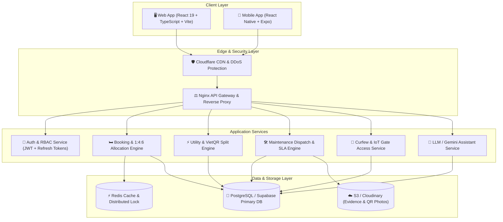
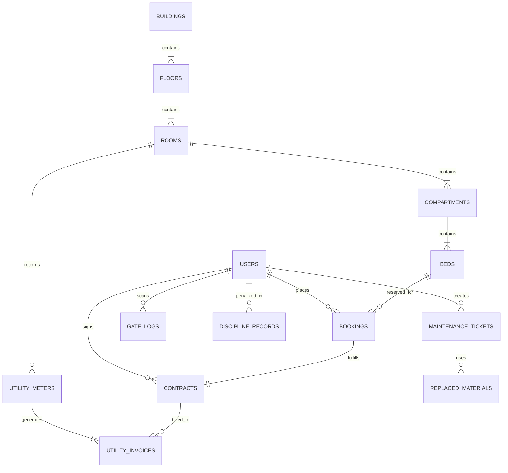

# Hệ Thống Quản Lý Ký Túc Xá FPT University (DMS)
## System Design & Architecture Specification (Kiến Trúc Hệ Thống)

---

## 1. Tổng Quan Kiến Trúc (High-Level Architecture)

Hệ thống Quản lý Ký túc xá (DMS - Dormitory Management System) được thiết kế theo mô hình **Modular Monolith với khả năng tách Microservices linh hoạt**, đáp ứng tải cao trong các đợt mở cổng đăng ký phòng đầu kỳ (lên đến hàng chục nghìn lượt truy cập đồng thời) và vận hành ổn định 24/7.

---

## 2. Giải Quyết Bài Toán Đặt Giường Cao Điểm (Concurrency & Locking)

Trong các đợt mở cổng đăng ký ký túc xá (Flash Registration):
- **Vấn đề:** Hàng trăm sinh viên cùng click vào 1 chiếc giường còn trống trong cùng 1 mili-giây dẫn đến rủi ro trùng lặp (Double Booking / Race Condition).
- **Giải pháp Kiến trúc:**
  1. **Distributed Lock với Redis (Redlock):** Khi sinh viên nhấn "Giữ chỗ", server xin Redis lock theo key `lock:bed:{bedId}` với TTL 10 phút.
  2. **Database Row-Level Locking:** `SELECT * FROM beds WHERE id = :bedId FOR UPDATE;`
  3. **Auto-Approval Pipeline:** Kiểm tra 3 điều kiện: (1) Giới tính khớp với Tòa; (2) Không nợ tiền kỳ trước; (3) Đã thanh toán 100% tiền cọc -> Kích hoạt hợp đồng tự động và phát hành thẻ phòng.

---

## 3. Mô Hình Dữ Liệu (Database ERD Diagram)

### Chi tiết các bảng nòng cốt:
1. **`users`**: `id, student_id, full_name, email, role (student/manager/technician/admin), gender, previous_debt, is_suspended`
2. **`buildings`, `rooms`, `compartments`, `beds`**: Cấu trúc topology KTX chuẩn 1:4:6 (1 phòng lớn chia 4 buồng riêng A/B/C/D, mỗi buồng 6 giường tầng).
3. **`bookings`**: `id, user_id, bed_id, status (HOLDING/PAID/APPROVED/CANCELLED), expires_at, created_at`
4. **`contracts`**: `id, booking_id, user_id, bed_code, semester, status, valid_from, valid_to`
5. **`maintenance_tickets`**: `id, title, scope, building, room, category, urgency, status, student_id, assigned_tech_id, description, evidence_images`
6. **`utility_invoices`**: `id, room_id, month, electric_kwh, water_m3, total_amount, per_student_amount, payment_status, vietqr_link`
7. **`gate_logs`**: `id, student_id, scanned_at, gate_name, direction (IN/OUT), is_after_curfew, pass_granted`

---

## 4. Cơ Chế Tự Động Chia Tiền Điện Nước (Auto-Split Utility Engine)

Mỗi phòng KTX 1:4:6 có:
1. **Công tơ buồng cá nhân (Private sub-meters):** Ghi nhận điện chiếu sáng & ổ cắm riêng của 4 buồng A, B, C, D -> Chia đều cho các sinh viên đang ở trong buồng đó.
2. **Công tơ khu vực chung (Shared meter):** Ghi nhận điện điều hòa trung tâm, bình nước nóng, đèn hành lang -> Chia đều cho toàn bộ sinh viên đang thuê trong phòng.
3. **Sinh VietQR động:** Tạo chuỗi mã QR EMVCo chứa sẵn số tiền chính xác, số tài khoản KTX và nội dung thanh toán `DIENNUOC_{PHONG}_{MSSV}` giúp hệ thống đối soát tự động khi webhook ngân hàng báo có.
